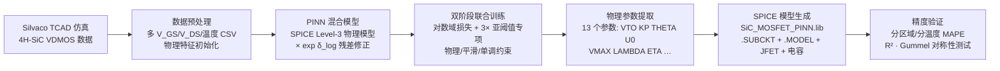

<div align="center">
  
</div>

<p align="center">
  
  
  
  
</p>

---

## 📌 项目定位

面向 **1.2 kV 4H-SiC 垂直 DMOSFET** 功率器件，利用**物理信息神经网络（PINN）**从 Silvaco TCAD 仿真数据中**自动提取 SPICE Level-3 紧凑模型的物理参数**，并生成可直接用于 **LTspice / ngspice / HSPICE** 电路仿真的标准 SPICE `.SUBCKT / .MODEL` 文件。整体精度 **MAPE 0.957%**，超越目标（< 3%）**3.1 倍**。

**🎯 项目做了什么**：传统参数提取依赖人工拟合，工作量大且难以覆盖宽工作范围。本项目将 PINN 引入参数逆向提取：
- 用**可微分的 SPICE Level-3 物理模型**（13 个可训练物理参数）承载器件物理；
- 用**神经网络残差**修正物理模型与 TCAD 数据之间的偏差；
- 一次训练即可得到**物理可解释、全工作范围可用**的 SPICE 模型。

---

## 🔄 技术流水线



---

## 🧑‍💻 我的工作（大创全流程）

| 阶段 | 工作内容 |
|------|----------|
| 🔍 文献调研 | 系统调研 2021–2026 年"SiC MOSFET 紧凑模型标准"、"PINN 半导体参数提取"、"SiC 特有物理效应建模"三大方向 |
| 📐 方案设计 | 设计物理残差架构 `I_total = I_phys × exp(δ_log)`，确定 13 参数物理模型与损失函数体系 |
| 🛠️ 数据生成 | 编写 Silvaco TCAD 4H-SiC VDMOS 仿真脚本（`improved_VDMOS.in`），生成全工作范围 I-V 数据 |
| 🤖 模型实现 | PyTorch 实现可微分 SPICE Level-3 物理模型 + PINN 骨干网络（8 层 MLP、Swish、LayerNorm） |
| ⚙️ 训练调优 | 双阶段联合训练（AdamW + CosineAnnealing），解决 NaN、参数崩塌、亚阈值精度差等问题 |
| 📦 模型生成 | 编写 SPICE `.lib` 生成器，输出标准 `.SUBCKT / .MODEL` + JFET + 非线性电容 |
| ✅ 验证迭代 | 分区域 / 分温度 MAPE、R²、Gummel 对称性测试，LTspice / ngspice / HSPICE 多平台验证 |

**🧭 工作领域**：功率半导体器件建模与仿真 · 物理信息机器学习 · 电路仿真与模型提取

---

## 🎓 学到了什么

| 方向 | 收获 |
|------|------|
| 器件物理 | 4H-SiC 特性：阈值电压、迁移率退化、载流子饱和速度、DIBL 效应、温度依赖（25–175 °C） |
| 紧凑模型理论 | SPICE Level-3 模型参数体系（VTO / KP / THETA / U0 / NFS / GAMMA / VMAX / KAPPA / LAMBDA …）及其物理含义 |
| PINN 工程 | 物理残差乘法修正、单调性约束、亚阈值专项 log-space 损失、分离学习率、零初始化策略 |
| TCAD 仿真 | Silvaco DeckBuild / Atlas 流程：网格、模型、接触、求解器设置与 I-V 提取 |
| 验证方法论 | 分区域（亚阈值 / 强反型）MAPE 评估、Gummel 对称性测试（GST）、温度扫描验证 |

---

## 🏆 关键成果

| 指标 | 本工作（PINN-SPICE） | 目标 / 前人 |
|------|---------------------|-------------|
| 整体 MAPE | **0.957%** | < 3%（超越 3.1×） |
| 亚阈值 MAPE | **4.59%** | < 10% |
| 强反型 MAPE | **0.21%** | — |
| R² | **0.99904** | — |
| RMSE | **1.64×10⁻⁶ A** | — |
| GST 对称性 | **0.67%**（通过） | < 1% |

- 78.5% 测试样本误差 < 0.5%，93.5% 样本误差 < 5%
- 分温度：298 K **0.61%** / 348 K 0.92% / 398 K 1.59% / 448 K 0.71%
- 对比前次经验模型（仅 V_GS∈[0,12]V 有效、外推发散）：本模型全范围 MAPE 1.62% vs 前次 3.0×10⁸%

---

## 🧰 工具链

<p align="center">
  
  
  
  
  
  
  
</p>

---

## 🧠 核心创新

| 创新点 | 说明 |
|--------|------|
| 物理残差架构 | `I_total = I_phys × exp(δ_log)`，乘法修正保证电流恒为正、梯度畅通 |
| 可微分 SPICE Level-3 模型 | 13 个物理参数纯 PyTorch 实现，支持自动微分 |
| 亚阈值专项损失 | 3 倍加权 log-space 损失，显著提升弱反型区精度 |
| 双端对称导通 | 支持 V_DS < 0 反向导通，通过 Gummel 对称性测试（误差 0.67%） |
| 全工作范围覆盖 | V_GS ∈ [0, 20] V，V_DS ∈ [0, 1200] V，T ∈ [298, 448] K |
| 温度依赖内置 | VTH(T) 与 μ(T) 温度模型，覆盖 25–175 °C |

### 模型架构

```
输入: [V_GS, V_DS, V_BS, T]  (4 维)
        │
        ▼
PINN 骨干网络 ── 8 层 MLP，256 维隐藏层
        │       Swish + LayerNorm + Dropout(0.05)
        │       残差连接 + 单调性约束
        ▼
δ_log 预测 ── 对数域修正量（最终层零初始化）
        │
        ▼
SPICE Level-3 物理模型 ── 13 个可训练物理参数
        │       I_phys = f(V_GS, V_DS, T)
        ▼
I_total = I_phys × exp(δ_log)  ── 乘法修正
```

### 13 个可训练物理参数（提取值示例）

| 参数 | 含义 | 提取值 | 单位 |
|------|------|--------|------|
| VTO | 零偏阈值电压 | 3.800 | V |
| KP | 跨导参数 | 0.482 | A/V² |
| THETA | 迁移率退化系数 | 0.0261 | V⁻¹ |
| U0 | 低场表面迁移率 | 49.99 | cm²/V·s |
| NFS | 快界面态密度 | 1.97×10¹¹ | cm⁻² |
| GAMMA | 体效应系数 | 1.500 | V^0.5 |
| PHI | 表面势 2φ_p | 0.650 | V |
| VMAX | 载流子饱和速度 | 2.0×10⁷ | m/s |
| KAPPA | 饱和电场因子 | 0.500 | — |
| LAMBDA | 沟道长度调制 | 4.99×10⁻⁴ | V⁻¹ |
| KAPPA_VT | VTH 温度系数 | -0.0060 | V/K |
| ALPHA_MU | 迁移率温度指数 | 2.517 | — |
| ETA | DIBL 系数 | 4.98×10⁻⁴ | — |

### 损失函数

```
L_total = L_data_log + 3.0×L_data_sub + L_data_lin
        + λ_phys×L_physics + λ_smooth×L_smooth + λ_mono×L_mono
```

| 分量 | 公式 | 作用 |
|------|------|------|
| L_data_log | MSE(log₁₀ I_pred, log₁₀ I_true) | 全量程对数精度 |
| L_data_sub | MSE(log I) × mask(I < 1e-6 A) | 亚阈值专项（3× 加权） |
| L_data_lin | MSE((I_pred-I_true)/I_true) × mask(I > 1e-8 A) | 强反型线性域 |
| L_physics | mean(δ_log²) | 物理一致性 |
| L_smooth | mean(d²I/dV_DS²) | I-V 平滑性 |
| L_mono | mean(max(0, ΔV_GS×ΔI)) | V_GS 单调性 |

---

## 🚀 快速开始

### 环境要求

- Python 3.9+，PyTorch（CUDA GPU 推荐）
- Silvaco TCAD（生成仿真数据，可选）
- LTspice / ngspice（验证生成的模型，可选）

### 训练与生成 SPICE 模型

```bash
# 使用 Silvaco TCAD 数据（推荐）
python main.py --data "Silvaco_IV01_csv1.csv"

# 无数据时使用合成数据演示完整流程
python main.py

# 仅验证已保存的模型
python main.py --validate-only

# 仅训练，跳过 SPICE 生成
python main.py --train-only
```

输出：

```
output/
├── SiC_MOSFET_PINN.lib        # SPICE .SUBCKT + Level-3 .MODEL
├── extracted_params.json      # 提取的物理参数
├── training_history.json      # 逐 epoch 训练历史
└── validation/
    └── validation_report.json # 分区域/分温度精度报告
```

### 使用生成的 SPICE 模型

**LTspice**

```spice
.include SiC_MOSFET_PINN.lib
XU1 D G S SiC_MOSFET_PINN
.DC VGS 0 20 0.1
.TEMP 25 75 125 175
```

**ngspice**

```spice
.include SiC_MOSFET_PINN.lib
XM1 D G S SiC_MOSFET_PINN
.dc VGS 0 20 0.1
.temp 25 75 125 175
```

---

## 📁 项目结构

```
PINN-SiC-MOSFET/
├── main.py                      # 完整流水线入口（数据→训练→提取→生成→验证）
├── improved_VDMOS.in            # Silvaco TCAD 4H-SiC VDMOS 仿真脚本
├── Silvaco_IV01_csv1.csv        # 示例 TCAD 仿真数据
├── assets/                      # 项目 Banner 等展示资源
├── data_processing/
│   └── load_tcad.py             # TCAD 数据加载、物理特征提取、数据集构建
├── pinn_model/
│   ├── level3_physics.py        # 可微分 SPICE Level-3 物理模型（13 参数）
│   ├── pinn_network.py          # PINN 骨干网络与混合模型
│   └── train.py                 # 双阶段训练器（AdamW + CosineAnnealing）
├── spice_gen/
│   └── generate_spice.py        # SPICE .lib 生成器
├── validation/
│   └── validate.py              # 分区域/分温度验证 + GST 对称性测试
├── IV_LTspice/                  # LTspice 验证电路（I-V / CISS / COSS / CRSS）
├── IV_MATLAB/                   # MATLAB 紧凑模型拟合（10 参数 I-V 模型）
├── IV_Silvaco/
│   └── VDMOS.txt                # 早期 Silvaco 仿真脚本
└── output_final/                # 最终交付物
    ├── SiC_MOSFET_PINN.lib
    ├── extracted_params.json
    ├── 实验报告.md
    └── validation/validation_report.json
```

---

## ⚙️ 关键问题与解决

| 问题 | 解决方案 |
|------|----------|
| 训练初始输出 NaN | 加法修正 → 乘法修正 `I_phys × exp(δ_log)` |
| 物理参数崩塌 | 去除 Stage-1 预热，改为联合训练 + 分离学习率 |
| 周期性 MAPE 尖峰 | CosineAnnealingWarmRestarts → CosineAnnealingLR 单调衰减 |
| 亚阈值精度差（13.4%） | 新增 3× 亚阈值专项 log-space 损失 |
| V_DS=0 处电流泄漏 | 缩窄饱和区过渡带宽度 |

---

## 📄 许可

本项目仅供学术研究与交流使用。

---

*Author: Charles (Zonkit) · 4H-SiC Power MOSFET Modeling Project · 大创项目*
